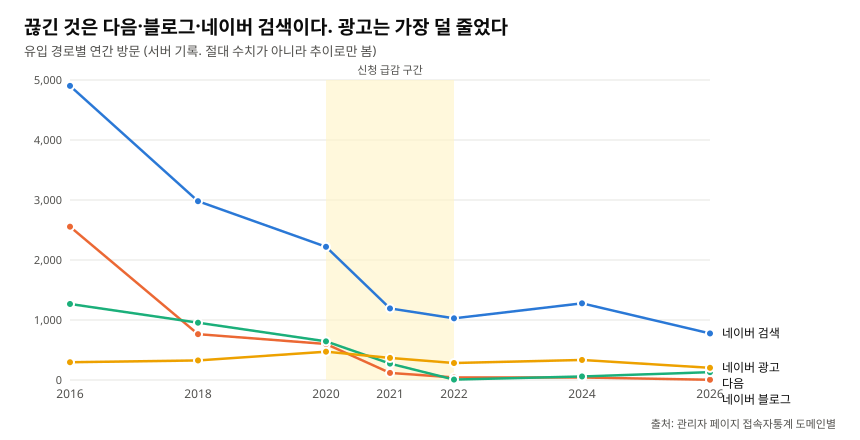
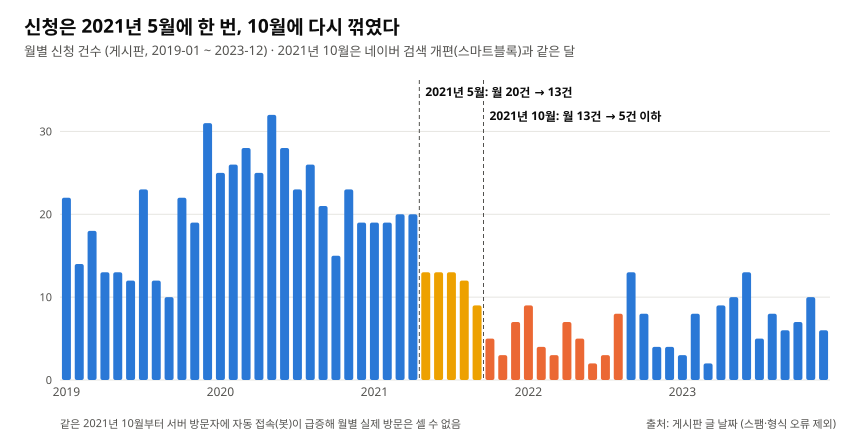
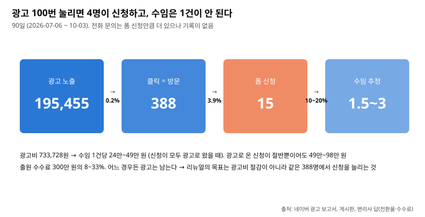
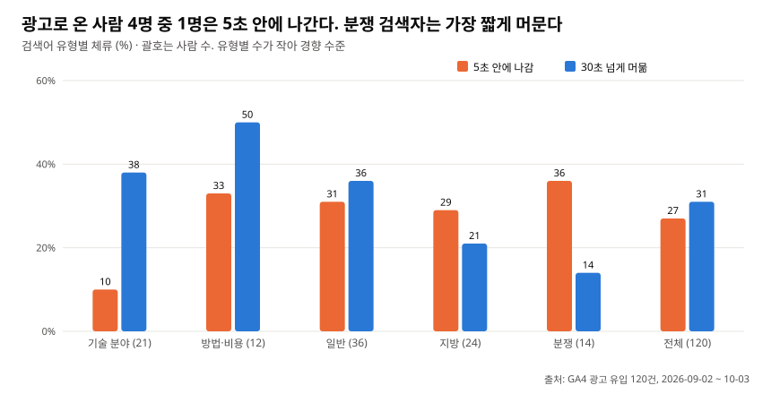
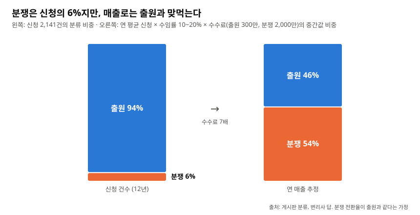

# ○○특허사무소 무료진단 랜딩페이지 리뉴얼 — 데이터 분석

**문제** 무료진단 신청이 308건(2020)에서 72건(2022)으로 줄고 회복되지 않음. 손실 연 약 6,000만\~1.2억 원. 목표 연 150건

**결과** 줄어든 236건 = 방문 감소 47% + 방문당 신청률 감소 53%(셰이플리 분해). 방문은 다음·블로그·네이버 검색에서 줄었고 광고는 원인 아님. 광고비 26%를 쓰는 포괄 검색어 9개의 클릭률은 구체적 검색어의 8분의 1

**해결책** 새 사이트(글자로, 첫 화면에 신청 칸, 분쟁 페이지) · 포괄 검색어 입찰 낮추기와 제외 키워드 · 신청마다 수임 여부 기록과 광고 신청 추적

- 기간: 2026-09-28 \~ 10-07
- 총 매출 = 수임당 매출 × 수임 전환율 × 방문당 신청률 × 방문수 → 1장 방문수, 2장 방문당 신청률, 3장 수임 전환율, 4장 수임당 매출, 5장 측정과 한계

---

# 1. 방문자수

- 서버 관리자 페이지의 접속자통계 / 연도별·OS별 방문자 / 2015 \~ 2025 / 같은 IP는 하루 1회

| 연도 | 전체 | 봇 추정 | 실제 방문 추정 |
|---|---|---|---|
| 2015 | 16,522 | 5,269 | **11,253** |
| 2018 | 14,421 | 5,076 | 9,345 |
| 2020 | 10,350 | 3,702 | **6,648** |
| 2021 | 16,707 | 11,931 | 4,776 |
| 2022 | 25,788 | 22,391 | **3,397** |
| 2023 | 25,852 | 21,942 | 3,910 |
| 2024 | 10,452 | 6,640 | 3,812 |
| 2025 | 20,451 | 11,564 | 8,887 (신뢰 낮음) |

- 봇 추정 = OS "Robot"·"Linux" 방문. 근거: 2021-10부터 방문이 월 900 → 2,100인데 신청은 월 12 → 5. 급증분은 전부 유입 경로 없는 "직접", 시간대 0\~23시 고름
- 2025 신뢰 낮음: Robot 8,848 급증, Chrome도 두 배인데 신청은 그대로 → Chrome인 척하는 자동 접속 추정
- 2026-09-02부터 방문은 GA4

=> 방문자수는 2015년(11,253)부터 꾸준히 감소, 2022년부터 3,000명대 횡보. 신청 급감 구간(2020→2022, 2장)에 6,648 → 3,397 절반

## 1-1. 유입 경로별 방문자수

- 접속자통계 / 유입 도메인별 방문 8종 / 2016 \~ 2026-10-06 / "직접"(봇 대부분) 제외
- 서버는 유입 경로를 놓치는 경우가 많아 추이로만 봄 (네이버 광고 보고서 90일 클릭 388 vs 서버 9달 203)

| 연도 | 네이버 광고 | 네이버 검색 | 네이버 블로그 | 다음 | 구글 | 신청(문자, 2장) |
|---|---|---|---|---|---|---|
| 2016 | 296 | 4,902 | 2,555 | 1,267 | 226 | 284 |
| 2018 | 326 | 2,980 | 764 | 955 | 9 | 301 |
| 2020 | 472 | 2,220 | 600 | 644 | 42 | 308 |
| 2021 | 368 | 1,193 | 118 | 273 | 32 | 163 |
| 2022 | 283 | 1,028 | 43 | 7 | 206 | 72 |
| 2024 | 334 | 1,278 | 42 | 59 | 24 | 105 |
| 2026 (10/6) | 203 | 776 | 4 | 131 | 45 | - |
| **2020→22** | -40% | **-54%** | **-93%** | **-99%** | | -77% |



=> 2020→2022년에 끊긴 것은 다음·블로그·네이버 검색. 광고는 가장 덜 감소 → 신청 감소의 원인은 광고가 아님

## 1-2. 다음

- 변리사 답: 다음 광고·등록 중단. 그 외 사무소 내부 변화 없음
- 2015\~2020년 연 640\~1,620 → 2022년 7

=> 확인된 원인. 중단 시점이 2021-05이면 신청이 처음 꺾인 달(2장)과 일치
=> action item: 다음(카카오) 재개를 비용 대 수익으로 검토. 2020년 수준(644)이면 신청률 4.6%로 연 30건, 수임 3\~6건. 비용은 카카오 광고 단가 확인 뒤

## 1-3. 블로그

- 사무소 네이버 블로그 / 글 2,706건의 날짜·제목, 최근 50건 본문 / 2014 \~ 2026
- 네이버 2021-10 "20년 만의 검색 개편"(스마트블록): 글 형식·주제 적합도로 노출을 가름 ([바이라인네트워크](https://byline.network/2021/10/26-173/), [아이보스](https://www.i-boss.co.kr/ab-6141-56894))

| 연도 | 블로그 글 | 블로그에서 온 방문 | 글의 성격 |
|---|---|---|---|
| 2014 | 109 | 37 | 승소율·FAQ·제도 안내 — 읽을 글 |
| 2015 | 242 | 401 | 등록/승소 리스트 (이후 계속) |
| 2016 | 238 | **2,555** | |
| 2017 | 264 | 1,587 | |
| 2018 | 165 | 764 | |
| 2019 | 180 | 1,102 | |
| 2020 | **318** | 600 | |
| 2021 | **322** | **118** | |
| 2022 | 248 | 43 | |
| 2024 | 206 | 42 | |
| 2025 | 183 | 17 | |
| 2026 | 12 (1/14 이후 없음) | 4 | |

- 최근 50건: 제목 전부 "특허등록 완료 / 2025년 12월 / 변리사 / 경기도 부천시" 틀, 본문은 등록증 사진 + 출원번호·등록일·의뢰인명(중앙값 317자). 글마다 사이트 첫 화면 배너 있음

=> 글의 양은 원인 아님 (가장 많이 쓴 2020\~21년에 600 → 118)
=> 후보 1: 글 형태 변화(읽을 글 → 실적 리스트). 검색 유입은 쌓인 글이 걸리면서 천천히 움직여 효과가 몇 년 뒤에 나타남. 2016년 정점 뒤 계단식 감소와 일치
=> 후보 2: 네이버 노출 방식 변화(2016 C-Rank, 2018 VIEW, 2021-10 스마트블록). 반복 형식 글을 밀어냄. 둘이 겹친 것으로 봄. 블로그 통계가 오면 가를 수 있음
=> action item: 읽을 내용이 있는 글로. 광고비 없는 경로지만 효과는 몇 년, 네이버에 달림

## 1-4. 네이버 검색

- 1-1의 표. 광고 아닌 네이버 검색 결과에서 온 방문. 4,902(2016) → 2,220(2020) → 1,028(2022) → 776(2026). 블로그와 같은 시기, 같은 방향

=> 사이트 쪽(글자가 전부 이미지라 검색엔진이 못 읽음) + 네이버 쪽(1-3과 같은 개편). 과거 검색 순위 자료가 없어 비중은 모름
=> action item: 리뉴얼로 글자를 텍스트로. 그 뒤 유입이 늘면 사이트 쪽 원인이 컸던 것

## 1-5. 네이버 광고 — 남은 방문의 3분의 2

- GA4 / 2026-09-02 설치 / 2026-09-02 \~ 10-01 / 작업자 접속 섞인 "직접" 69세션 제외, 광고 주소로 온 **120건**만 (10-06부터 작업자 IP 차단)
- 네이버 광고 보고서 / 키워드·검색어·광고그룹 / 2026-07-06 \~ 10-03 (90일, 한 번에 90일, 기록 2년) / 비교용 2025-07-02 \~ 09-29
- 90일: 노출 195,455 · 클릭 **388** · 비용 733,728원 · 클릭률 0.20% · 클릭당 1,891원 · 키워드 1,069개 · 실제 검색어 9,383개 · 전환 측정 없음

| 항목 | 값 |
|---|---|
| 옛 사이트 세션 (1개월) | 약 180 |
| 그중 광고 주소로 온 방문 | **120** (출원 101 · 분쟁 19) |
| 같은 기간 네이버 광고 클릭 | 130 → GA4 120과 일치, 두 데이터를 이어서 봄 |
| 광고그룹이 보내는 페이지 | 24개 중 분쟁 3개만 분쟁 페이지. 21개는 첫 화면 → 출원 페이지로 자동 이동 |
| 기기 (신청 페이지 142명) | PC 79 · 모바일 62 · 태블릿 1 → **모바일 44%** |
| GA4 채널 분류 | 광고 링크에 UTM이 없어 "자연 검색"으로 오분류 → 10-06 수정 |

=> 실제 방문의 3분의 2가 광고 → 랜딩은 광고 방문자 기준, 휴대폰부터 (사이트는 PC 폭 고정)
=> 첫 화면 경유는 체감 차이 없으나 광고 검색어가 사라지고 조회수가 두 번 셈 → 리뉴얼에서는 광고가 바로 해당 페이지로

## 1-6. 광고 키워드

```
검색어 (사람이 친 말, 9,383개) ─네이버가 짝지음(비슷하면 확장 검색)─ 키워드 (등록한 말, 1,069개) ⊂ 광고그룹 (24개, 예산·입찰·연결 페이지)
노출 195,455 (돈 안 나감) → 클릭 388 (평균 1,891원) → 사이트 → 100명 중 4명 신청 (2-1)
```

- 1-5의 광고 보고서. 검색어 9,383개를 글자 규칙으로 11개 유형 분류(클릭 난 231개는 검산)
- 변리사 답: 2025년 정리는 본인이 직접(비용 절약). 직접 관리, 상한 월 100만(현재 24만). 상표만 있는 문의 원치 않음. 지방 선호. 기술 분야를 내세우는 것은 원치 않음(다른 분야 고객 이탈 우려)

**광고그룹 (2026, 비용순)**

| 광고그룹 | 노출 | 클릭 | 클릭률 | 비용 | 비중 |
|---|---|---|---|---|---|
| 특허사무소 | 131,108 | 106 | **0.1%** | 266,227 | **36%** |
| 특허실용출원 | 13,369 | 40 | 0.3% | 99,122 | 14% |
| IT | 1,816 | 23 | 1.3% | 57,747 | 8% |
| 특허심판 | 3,032 | 18 | 0.6% | 50,972 | 7% |
| 강남변리사 | 864 | 19 | 2.2% | 40,512 | 6% |
| 기타분야·특허소송·BM특허·기계 | 4,162 | 47 | 1.1% | 102,754 | 14% |
| 심사관출신 | 132 | 7 | **5.3%** | 18,468 | **2.5%** |
| 그 외 13개 | 41,040 | 128 | 0.3% | 98,427 | 13% |

**특허사무소 그룹 안 (비용 36%의 내역)**

| 검색어 묶음 | 노출 | 클릭 | 클릭률 | 비용 | 전체 광고비 비중 |
|---|---|---|---|---|---|
| 한두 단어 포괄 검색어 (특허·특허법인·변리사·특허사무소·특허출원) | 126,690 | 73 | **0.06%** | 185,900 | **25%** |
| 구체적 검색어 400여 개 | 4,418 | 33 | **0.75%** | 80,319 | 11% |
| 그중 "특허" | 74,443 | 23 | 0.03% | 71,572 | 10% |
| 그중 "특허출원" | 718 | 9 | 1.25% | 26,456 | 4% |

- 클릭당 비용은 포괄 검색어 2,547원, 구체적 2,434원으로 같음
- 확장 검색(키워드 "-") 25,588노출 81클릭, 비용 17%. 어떤 검색어인지 알 수 없음. 그룹별 클릭률 0.9\~1.3%

**검색어의 뜻별**

| 유형 | 클릭 | 클릭률 | 비용 비중 | 클릭당 |
|---|---|---|---|---|
| 일반 (특허·변리사·특허사무소·특허법인) | 166 | 0.1\~0.2% | **52%** | 2,000\~2,500원 |
| 기술 분야 (IT·BM·AI·기계·전기…) | 59 | 1.7% | **18%** | 2,220원 |
| 분쟁 (경고장·침해·소송·심판·무효) | 21 | 0.3% | 7% | 2,596원 |
| 지역명 | 69 | 1.9% | 7% | **706원** (지방 300\~700) |
| 방법·절차·비용 | 24 | 0.4\~1.0% | 8% | 1,900\~2,600원 |
| 상표 | 6 | 0.6% | 1.9% | 2,281원 |
| 심사관 출신 | 11 | **5.0%** | 3.4% | 2,280원 |
| 상호 | 18 | **32.7%** | 1.7% | 699원 |

**작년 정리 전후 (90일)**

| | 2025 | 2026 | 변화 |
|---|---|---|---|
| 광고비 | 1,337,303원 | 733,728원 | **-45%** |
| 클릭 | 671 | 388 | -42% |
| 클릭당 비용 | 1,993원 | 1,891원 | -5% |
| 신청 | 18 | 15 | **-17%** |

- 줄인 그룹: 특허사무소 54만 → 27만, 무료진단_A 2개 삭제(35만 → 0)

=> 특허사무소 그룹이 비싼 이유는 그 안의 포괄 검색어 몇 개. 구체적 검색어는 12배 자주 눌리는데 클릭당 비용은 같음 (우연일 확률 0.1% 미만)
=> 광고비 절반 감액에 신청은 -17%. 18 → 15는 우연일 확률 73%라 확정은 아니나, 광고비대로 줄었다면 기대 9.9건 → 15건 이상일 확률 8% → "덜 줄었다"는 경향
=> action item (뺌): 특허·특허법인·변리사·특허사무소 입찰 낮추거나 제외 (광고비 21%, 클릭 16%). "특허출원"은 남김. 확장 검색은 성적 나쁜 그룹부터 끔. "변리사파견" 무관 노출(5,766회), 경쟁사 상호 검색(3클릭 8,864원) 정리
=> action item (늘림): 지방 키워드 (706원, 클릭률 1.9%, 우연일 확률 0.1% 미만, 변리사 선호). 랜딩에 "전국 어디서나 전화·이메일". 심사관출신 그룹 (클릭률 1위, 비용 2.5%)
=> 사이트 문구로: 기술 분야 검색은 15% → 전면에 안 내세움(변리사 판단과 일치). 검색어가 기술 분야일 때만 한 줄. 심사관 출신 검색은 3% → 찾아오게 하는 말이 아니라 남게 하는 말
=> 변리사 결정: 상표 제외 (클릭 6, 비용 2%, 상표 신청 2015년 이후 거의 0)
=> 광고는 직접 관리라 바로 실행, 4주 단위. 상한 증액은 전환을 고친 뒤 구체·기술·분쟁·지방 순

---

# 2. 방문당 신청률

- 알림 문자 / 관리자 문자 전송내역(신청마다 사무소로 가는 문자의 시각) / 2014-11 \~ 2026-10-05 / 2,895 → 2026-07 스팸 254 제외 → **2,641**
- 게시판 / 신청 게시판 3개(간편·출원·분쟁)의 번호·날짜·분류 / 2014-12 \~ 2026-10-04 / 2,174 → 스팸 10, 휴대폰 형식 아님 23 제외 → **2,141**
- 신청 수의 기준은 문자: 게시판 글은 일부 지워졌으나(변리사 답) 문자는 남고, 2017\~2025년 두 집계가 일치. 분류가 필요한 집계(3·4장)는 게시판

| 연도 | 게시판 | 문자 | 실제 방문 (1장) | 방문당 신청률 |
|---|---|---|---|---|
| 2014 | 64 | 111 | | |
| 2015 | 289 | **506** | 11,253 | **4.5%** |
| 2016 | 199 | 284 | | |
| 2017 | 275 | 308 | | |
| 2018 | 268 | 301 | 9,345 | 3.2% |
| 2019 | 209 | 223 | | |
| 2020 | 291 | **308** | 6,648 | **4.6%** |
| 2021 | 153 | **163** | 4,776 | 3.4% |
| 2022 | 70 | **72** | 3,397 | **2.1%** |
| 2023 | 87 | 92 | 3,910 | 2.4% |
| 2024 | 100 | 105 | 3,812 | 2.8% |
| 2025 | 82 | 87 | (신뢰 낮음) | |
| 2026 (10/5) | 54 | 81 | | |

**월별 (게시판)**

| 구간 | 월 평균 |
|---|---|
| 2020-01 \~ 2021-04 | 23 |
| 2021-05 \~ 2021-09 | **12** — 첫 꺾임 |
| 2021-10 \~ 2022-08 | **5** — 둘째 꺾임 |
| 2022-09 \~ 2023-12 | 7 |



- 2021-10 = 네이버 스마트블록 발표 달(1-3) = 서버 봇 급증 시작(1장). 2021-05 = 다음 중단? [변리사 확인]

=> 신청은 308(2020) → 72(2022), 4분의 1. 2023\~25년 87\~105로 회복 안 됨
=> 꺾임 두 번 → 한 번에 무너진 것이 아니라 경로가 둘 끊김
=> 방문당 신청률 4.6% → 2.1% 절반. 방문도 절반 → 신청 4분의 1
=> 감소 236건 = 방문 몫 **47%**(110) + 신청률 몫 **53%**(126). 떼는 순서에 따라 36\~71%라 평균(셰이플리)
=> 연 200건 감소 = 연 6,000만\~1억 2,000만 원 (수임 10\~20%, 수수료 300만)
=> action item: 목표 연 150건. 방문 3,812(2024) 그대로 두고 신청률만 4.6%로 되돌리면 177건, +72

## 2-1. 지금 수준 — 클릭 100번에 신청 4건

- 1-5의 광고 90일 + 같은 기간 게시판. 변리사 답: 직접 전화 신규 문의 월 5건 이내, 수임 10\~20%, 수수료 출원 300만·분쟁 2,000만

| 단계 | 값 |
|---|---|
| 노출 | 195,455 |
| 클릭 | 388 (0.2%) |
| 폼 신청 | **15** (출원 12, 분쟁 3) — **클릭의 3.9%** |
| 직접 전화 | 15 이내 — 기록 없음 |
| 수임 추정 | 폼 1.5\~3, 전화 포함 최대 3\~6 |
| 광고비 | 733,728원 |

| 광고로 온 신청 | 수임 1건당 광고비 | 수수료 300만 대비 |
|---|---|---|
| 15건 전부 | 24만\~49만 | 8\~16% |
| 3분의 2 (9월 방문 비율) | 37만\~73만 | 12\~24% |
| 절반 | 49만\~98만 | 16\~33% |



=> 어느 경우든 광고는 남음
=> action item: 목표는 광고비 절감이 아니라 같은 클릭에서 신청 늘리기
=> 15건으로 검색어별 전환율은 못 말함 → 신청 글에 검색어가 쌓이면(5-1) 리뉴얼 뒤

## 2-2. 왜 — 4명 중 1명은 5초 안에 나간다

- 1-5의 GA4 / 광고 유입 120건의 참여 시간 / 유형별 4\~36건이라 경향
- Clarity 녹화 / 10-06 설치 / 작업자 제외 첫 5건

| 전체 120건 | 중앙값 **18초** · 30초 이상 **31%** · 5초 이하 **27%** |
|---|---|

| 유형 (1-6) | 건수 | 중앙값 | 30초 이상 | 5초 이하 |
|---|---|---|---|---|
| 기술 분야 | 21 | 20초 | 38% | **10%** |
| 방법·비용 | 12 | 31초 | **50%** | 33% |
| 일반 | 36 | 20초 | 36% | 31% |
| 지역(지방) | 24 | 16초 | 21% | 29% |
| 분쟁 | 14 | 17초 | **14%** | 36% |



- Clarity 5건: 4건은 20\~34초 읽음(스크롤, 마우스로 글줄 짚기), 1건 즉시 이탈. 폼·전화번호 접촉 0. 모바일 1건은 좌우로 끌며 읽음(PC 폭 그림)
- 유형별 차이의 우연일 확률: 기술 분야 6%, 방법·비용 19%, 분쟁 22% → 경향

=> 4분의 1이 5초 안에 나감. 나머지는 읽고 나서 신청하지 않음
=> action item: 18초 안에 "누가·무엇을·무료로". 읽기 끝나는 자리에 간편 신청. 휴대폰 대응. 방법·비용 검색자용 비용·절차 블록(금액 공개 가능, 변리사). 분쟁 페이지는 4-1

---

# 3. 수임 전환율

## 3-1. 데이터가 없다 — 신청 뒤는 전화

- 측정된 데이터 없음. 변리사 기억(수임 10\~20%)뿐
- 변리사 답: 진단은 간편·상세 모두 전화. 직접 전화 월 5건 이내, 어디서 번호를 봤는지 모름, 손으로 기록은 번거로움. "365일 8시\~24시, 몇 분 내 연락" 유지
- 2장의 게시판 형태·분류, 문자 시각, 1-5의 광고 요일별

| | 간편 (휴대폰만) | 출원 상세 | 분쟁 상세 |
|---|---|---|---|
| 건수 | **1,730 (81%)** | 386 | 25 |

- 분류: 특허·실용신안 69% · 기타 11% · 디자인 9% · 분쟁 6% · 국제 5% · 상표 1%. 분류 이름이 시기마다 다름

| | 월 | 화 | 수 | 목 | 금 | 토 | 일 |
|---|---|---|---|---|---|---|---|
| 광고 클릭 (90일) | 60 | 70 | 69 | 66 | 52 | **34** | **37** |
| 신청 (12년) | 463 | 550 | 481 | 459 | 420 | **268** | **254** |

- 시간대: 0\~7시 13% · 12\~17시 **39%** · 주말 감소는 우연일 확률 0.1% 미만

=> 네 요인 중 유일하게 데이터 없음. 신청 뒤(전화 → 수임)는 사이트 밖 → 측정이 먼저
=> 전화 문의가 폼만큼 있는데 안 잡힘. 휴대폰(44%)은 번호 클릭으로 셀 수 있고 PC(56%)는 못 셈
=> action item: 휴대폰 번호 클릭 기록. PC는 사이트 전용 착신 번호 (변리사 동의 뒤). 수임 여부는 분기 1회
=> action item: 간편 신청 유지(첫 화면·읽기 끝). 분류 5개 통일(특허·실용신안 / 디자인 / 분쟁 / 국제 / 기타). "기타" 11% 미확인
=> action item: "결과 리포트" 문구 대신 "전화로 알려 드리는 것"(가능성·보완점·비용) 항목화. 0\~7시 신청(13%)에 "오전 8시 이후 연락"

---

# 4. 수임당 매출

## 4-1. 분쟁은 건수의 6%, 매출은 출원과 맞먹는다

- 2장 게시판 분류, 1-5 광고 분쟁 그룹. 변리사 답: 수수료 출원 300만·분쟁 2,000만, 사이트 경유 분쟁 수임 2건, 분쟁은 전화·소개가 주

| | 신청 12년 | 그중 간편 | 연 평균 (2023\~25) | 수수료 | 연 매출 추정 (전환 10\~20%) |
|---|---|---|---|---|---|
| 출원 | 2,021 (94%) | 1,635 | 76 | 300만 | 2,300만\~4,600만 |
| 분쟁 | 120 (6%) | 95 (79%) | 13 | 2,000만 | **2,700만\~5,300만** |



- 분쟁 신청 연도별 28(2015) · 8(2020) · 12(2023) · 22(2024) · 6(2025): 변동 크고 전체 감소 뒤에도 안 줄음
- 분쟁 광고: 비용 12%, 클릭당 최고 7,127원, 광고 유입의 16%

=> 수수료 7배라 연 매출은 출원과 비슷하거나 더 큼 (분쟁 전환율 = 출원 가정)
=> action item: 분쟁 페이지를 리뉴얼 우선순위에. 분쟁 광고는 줄이지 않음
=> action item: 분쟁 페이지는 폼보다 전화 (79%가 번호만 / 변리사: 전화·소개가 주)
=> 분쟁 검색자가 가장 짧게 머묾(2-2) → 페이지 문제 가능성

---

# 5. 측정과 한계

## 5-1. 설치한 측정 (2026-10-06, 옛 사이트 머리글 파일 하나)

| 넣은 것 | 왜 | 확인 |
|---|---|---|
| 광고 유입을 GA4에 광고/검색어/광고그룹으로 | 자연 검색 오분류(1-5) | 확인 |
| 입구 구분 (출원/분쟁/간편) | 나눠 보려고 | 확인 |
| 폼 시작·제출 시도·완료 이벤트 | 전환율(2-1) | 10-07 휴대폰 시험으로 확인. 이름이 GA4 자동 이벤트와 겹쳐 `apply_*`로 |
| 신청 글에 유입 경로·검색어 저장 | 어떤 검색어가 신청이 됐나 | DB에서만 확인 가능, 미확인 |
| 첫 화면의 검색어를 신청 페이지로 넘김 | 넘기며 사라지고 있었음 | 확인 |
| Clarity 녹화 | 5초 이탈의 이유(2-2) | 확인. 그림 페이지라 스크롤 깊이 부정확 |
| 옛 UA 코드 제거, 작업자 IP 차단 | 깨끗한 데이터 | 확인 |
| 네이버 전환 추적 스크립트 | 광고 보고서에 전환 | 서비스 신청함, 승인 뒤 설치 |

## 5-2. 한계

| 한계 | 내용 |
|---|---|
| 표본 | 신청 90일 15건, 광고 유입 120건 |
| 기간 | 신청 12년, 광고 90일, GA4 1개월 |
| 서버 통계 | 봇 제거는 추정, 경로는 추이, 2025년 이후 신뢰 낮음 |
| 수임 전환율 | 데이터 없음 |
| 변리사 답 | 수임률·수수료·문의 건수 등은 기록이 아닌 기억에 의한 대략의 값 |
| 확장 검색 | 네이버가 붙인 실제 검색어는 보고서에 안 나옴 |
| 2021년 원인 | 다음 중단 확인. 블로그·네이버 검색은 추정 |
| 다른 매체 | 구글 미검토. 상한 100만 안에서 나누면 둘 다 학습 안 됨 → 전환 측정 뒤 |

**검정** (5% 아래면 우연이라 보기 어려움)

| 주장 | 절 | 우연일 확률 | 검정 |
|---|---|---|---|
| 포괄 검색어보다 구체적 검색어가 자주 눌림 | 1-6 | **0.1% 미만** | 피셔 |
| 지역명이 일반보다 자주 눌림 | 1-6 | **0.1% 미만** | 피셔 |
| 신청 18 → 15는 차이 아님 | 1-6 | **73%** | 이항 |
| 광고비 -45%에 신청이 비례해 줄지 않음 | 1-6 | **8%** | 포아송 |
| 기술 분야 5초 이탈 적음 | 2-2 | **6%** | 피셔 |
| 방법·비용 오래 머묾 / 분쟁 짧게 머묾 | 2-2 | **19% / 22%** | 피셔 |
| 주말 신청 적음 | 3-1 | **0.1% 미만** | z |

- 단단: 신청 추이, 다음 중단, 광고 3분의 2, 포괄 검색어 클릭률, 간편 81%
- 무름: 돈 환산 전부, 블로그·검색 원인, 유형별 체류, 수임 전환율
